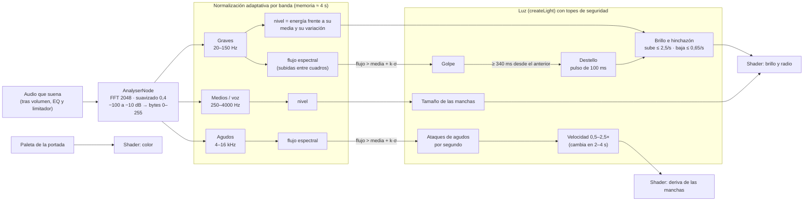

# Luces reactivas: de dónde sale cada efecto

Qué hace el fondo **Ritmo** del reproductor con la música, paso a paso. Código: `src/core/rhythm.ts` (análisis y luz, puro y con
tests), `src/ui/Backdrop.tsx` (bucle de dibujo) y `src/ui/backdropRenderer.ts` (shader). Las cifras de este documento se miden con
`scripts/medir-luces.ts` (§8).

## 1. El recorrido en una imagen



El color **no** sale del audio: viene de la portada (o del acento o del tono elegido). La música cambia el brillo, el tamaño y la
velocidad de las manchas, nunca su tono.

## 2. Las tres bandas

El analizador entrega 1024 valores (cada uno, ~22 Hz de ancho) en escala logarítmica: un byte por cada 0,35 dB entre −100 dB
(silencio) y −10 dB. Se agrupan en tres bandas que no se solapan:

| Banda | Frecuencias | Qué suele haber | Efecto que mueve |
|---|---|---|---|
| Graves | 20–150 Hz | Bombo, 808, bajo | Brillo e hinchazón; sus ataques, los destellos |
| Medios / voz | 250–4000 Hz | Voz, guitarras, teclados, caja | Tamaño de las manchas (un ajuste suave) |
| Agudos | 4–16 kHz | Hi-hats, platos, sibilantes | Velocidad de la deriva |

150–250 Hz queda fuera a propósito: ahí se mezclan el bajo y el cuerpo de la voz, y contaminaría las dos bandas.

## 3. Cómo se normaliza la señal

Cada canción viene masterizada a un volumen y con una compresión distintos, y además pasa por tu volumen y tu ecualizador antes de
llegar al analizador. Por eso nada se compara con un valor fijo: **cada banda se compara con su propio pasado reciente**.

- **Energía de la banda:** media de sus bytes, de 0 a 1.
- **Media y variación móviles:** medias exponenciales con una constante de 4 s (`NORM_MS`). Al empezar se usa la media acumulada,
  así que se adapta en el primer segundo.
- **Nivel normalizado:** `0,5 + (energía − media) / (spread · σ)`, recortado entre 0 y 1. La media cae en 0,5; `spread/2`
  desviaciones por encima o por debajo llegan a 1 o a 0.
- **Suelo de variación:** σ nunca baja de 0,01 (≈ 0,9 dB). Un tono constante o un ruido de fondo no se amplifican hasta parecer
  música: quedan en 0,5, quietos.
- **Silencio:** por debajo de 0,03 (≈ −97 dB) la banda da 0 y no hay ataques. Las medias se **congelan**, de modo que una pausa no las
  arrastra a cero y al reanudar la luz sigue calibrada.

## 4. Ataques: el flujo espectral

Un ataque (bombo, caja, hi-hat) es una **subida brusca** de energía. Cada cuadro se suman, en la banda, solo las subidas de cada
valor respecto al cuadro anterior (las bajadas no cuentan) y se divide por el número de valores: es el *flujo espectral*. Como la
escala está en dB, un golpe sube lo mismo suene fuerte o bajo.

Hay ataque cuando se cumplen todas:

| Condición | Valor | Por qué |
|---|---|---|
| Flujo por encima de su media móvil más `k` desviaciones típicas | `k` según la sensibilidad (§6) | Umbral relativo: se adapta a lo "ocupada" que esté la canción |
| Desviación típica del flujo de al menos 0,002 | `MIN_FLUX_DEVIATION` | Sin esto, un fondo muy quieto convertiría cualquier roce en golpe |
| Flujo de al menos 0,003 (≈ 0,3 dB de subida media) | `MIN_FLUX` | Suelo absoluto para el ruido |
| Al menos 30 cuadros (½ s) desde que la banda empezó a sonar | — | Calentamiento de las medias |
| Separación desde el ataque anterior | 200 ms en graves y medios, 90 ms en agudos | 200 ms admite hasta 300 BPM |

## 5. Qué dispara cada efecto

### Destellos
Un **golpe** (ataque en los graves) dispara un destello si han pasado al menos **340 ms** desde el anterior. El destello es un
pulso que se mantiene 100 ms, con ataque de 70 ms y caída de 300 ms.

### Brillo e hinchazón (`swell`)
- Objetivo: `0,6 · graves + 0,45 · pulso`, con los graves ya normalizados y seguidos con ataque de 90 ms y caída de 450 ms.
- El valor real persigue al objetivo con dos topes: **sube como mucho 2,5 por segundo y baja como mucho 0,65 por segundo**.
- En el shader: cada mancha se ilumina por `0,9 + 0,35 · swell` y su radio crece `0,2 · swell`.

### Tamaño
Los medios normalizados (ataque 120 ms, caída 500 ms) añaden hasta `0,04` al radio. Es el efecto más discreto: da cuerpo cuando
entra la voz sin competir con los graves.

### Velocidad
- Se cuentan los **ataques de agudos por segundo** (media de ~3 s). 6 por segundo o más es el máximo.
- Esa densidad pasa por una envolvente lenta (sube en ~2 s, baja en ~4 s) y da un multiplicador de **0,5× a 2,5×**: 1,5 ataques por
  segundo es ×1, sin agudos es ×0,5. Se multiplica por la «Velocidad» que elijas.
- La fase de la deriva se integra cuadro a cuadro, así que la velocidad cambia sin saltos.

### Color
No reacciona al audio. Cambia al cambiar de pista (transición de ~250 ms) o al deslizar el carrusel de portadas.

## 6. Topes de seguridad y sensibilidad

Estos topes no dependen de la canción ni de la sensibilidad:

| Tope | Valor | Garantía |
|---|---|---|
| Separación entre destellos | 340 ms | ≤ 2,9 golpes de luz por segundo (WCAG 2.3.1 pide ≤ 3) |
| Subida del brillo | 2,5 /s (`SWELL_SLEW`) | En 100 ms el brillo cambia como mucho un 7 % (límite: 10 %) |
| Bajada del brillo | 0,65 /s (`SWELL_FALL`) | Un cambio que cuenta como destello (5 % de brillo, el doble de exigente que WCAG) tarda ≥ 72 ms en subir y ≥ 277 ms en bajar: ≥ 349 ms por ciclo, así que **ni los graves ni los golpes pueden pasar de 2,9 destellos por segundo**, por construcción |
| Movimiento reducido | — | Sin lienzo ni bucle: el mismo degradado en CSS, quieto (el del sistema se respeta siempre; también el de Ajustes) |
| Modo Portada | — | Sin análisis: velocidad fija y brillo quieto |

**Sensibilidad** (Ajustes → Apariencia y luces, o menú ≡ → Fondo, solo en Ritmo). Las tres se adaptan a cada canción; cambian el
umbral de los ataques y cuánto recorre el nivel:

| Sensibilidad | `k` (umbral de ataque) | `spread` (desviaciones de 0 a 1) |
|---|---|---|
| Baja | 2,0 | 6 |
| Auto (por defecto) | 1,6 | 4 |
| Alta | 1,3 | 2,5 |

## 7. Por qué había canciones que apenas se movían (diagnóstico)

Medido con el audio real de *Highest in the Room* (Travis Scott) y *The Spins* (Mac Miller), del minuto 0:40 al 1:40, por el mismo
camino que el navegador (simulación del analizador en `src/core/rhythm.sim.ts`):

| Valor de la versión anterior | Highest in the Room | The Spins |
|---|---|---|
| Graves (p5 / p50 / p95) | 0,71 / 0,94 / 1,00 | 0,90 / 0,97 / 1,00 |
| Flujo del bombo (p95 / p99) | 0,035 / 0,089 | 0,045 / 0,077 |

Tres causas:

1. **Saturación.** El analizador usaba su rango de serie, hasta −30 dB. Los graves de un máster actual pasan de ahí y se quedaban
   pegados a 255. En *The Spins* (bajo continuo, máster comprimido) la banda iba de 0,90 a 1,00 y, multiplicada por 1,15, era
   **siempre 1**: brillo plano. *Highest in the Room* tiene silencios entre los 808 (p5 0,71), y por eso sí se movía algo.
2. **Umbral de golpe absoluto.** Un golpe exigía un flujo de 0,25, calibrado con bombos sintéticos (≈ 0,8). En música real el flujo
   casi nunca pasa de 0,09: **casi no había destellos** (0,10/s y 0,00/s en las canciones completas).
3. **Ganancias fijas** (×1,15 graves, ×1,8 medios, ×3 agudos). Con un máster fuerte todo se recortaba a 1 y la velocidad, ligada al
   volumen, se quedaba en el tope.

Arreglo: rango del analizador −100 a −10 dB (`ANALYSER_DB`, lo fija el motor), normalización por banda (§3), ataques con umbral
relativo (§4) y velocidad por densidad de agudos (§5).

## 8. La métrica de actividad y los resultados

`lightMetrics` (`src/core/rhythm.sim.ts`) mide la luz que llega al shader, cuadro a cuadro a 60 fps:

- **Actividad:** desviación típica del brillo dentro de ventanas de 2 s, de media, en puntos (brillo de 0 a 100). Cuánto late la luz
  al ritmo; un fondo quieto da 0. Las ventanas cortas ignoran los cambios lentos (de estrofa a estribillo).
- **Destellos/s:** destellos disparados por segundo, de media.
- **Velocidad σ:** cuánto varía el multiplicador de velocidad a lo largo de la canción.
- **Topes:** destellos en la peor ventana de 1 s (≤ 3, contando cambios de brillo ≥ 5 %) y mayor cambio de brillo en 100 ms (< 0,10).

**Criterio:** ninguna canción baja de actividad y ninguna pasa de los topes.

Canciones completas, sensibilidad Auto. Antes = `core/rhythm.ts` de `cc1470f`.

| Pista | Actividad | Destellos/s | Velocidad σ | Peor destellos/s | Máx. paso 100 ms |
|---|---|---|---|---|---|
| Highest in the Room · antes | 0,73 | 0,10 | 0,175 | 1,0 | 0,070 |
| Highest in the Room · **después** | **2,55** | **1,02** | **0,314** | 2,5 | 0,070 |
| The Spins · antes | 0,09 | 0,00 | 0,112 | 0,5 | 0,070 |
| The Spins · **después** | **2,11** | **2,04** | **0,151** | 2,5 | 0,070 |
| Sintética de poca dinámica (30 s) · antes | 0,70 | 0,00 | 0,088 | 0,0 | 0,070 |
| Sintética de poca dinámica (30 s) · **después** | **2,56** | **1,13** | **0,110** | 2,0 | 0,070 |

Fragmentos de 30 s desde el minuto 1:00: *Highest in the Room* 0,93 → 2,71 de actividad (0,07 → 0,67 destellos/s); *The Spins*
0,46 → 2,16 (0,00 → 1,47 destellos/s). Peor ventana ≤ 2,5 destellos/s en ambos.

Otras siete pistas de géneros variados (rap, pop, rock de los setenta, hyperpop, reguetón): actividad antes 0,46–1,45, después
2,44–3,01; peor ventana ≤ 3,0 destellos/s y paso ≤ 0,070 en todas. **Antes, de la canción más quieta a la más viva había un factor 16;
ahora, 1,4.**

Sensibilidad (actividad, Baja / Auto / Alta): *Highest in the Room* 2,11 / 2,55 / 2,93; *The Spins* 2,14 / 2,11 / 2,07. En *The Spins*
apenas cambia: con ~2 golpes por segundo lo que limita es la bajada máxima del brillo, que es un tope de seguridad.

El máximo cambio en 100 ms es 0,070 en todas porque coincide con el tope de subida (2,5/s · 0,1 s · 0,35 / 1,25): se alcanza, nunca se
supera.

### Cómo repetir la medición

```bash
# Requiere ffmpeg. El audio no sale de tu equipo ni se versiona (src/assets/music/ está ignorada por git).
node scripts/medir-luces.ts "src/assets/music/<pista>.flac"                       # versión actual
node scripts/medir-luces.ts --antes cc1470f "src/assets/music/<pista>.flac"        # versión anterior, para comparar
node scripts/medir-luces.ts --desde 60 --segundos 30 --sensibilidad high <pista>   # un fragmento, otra sensibilidad
```

## 9. Límites

- Las cifras salen de una **simulación** del analizador (misma ventana, FFT, suavizado y escala que la especificación de Web Audio),
  no del navegador: allí el analizador mezcla el estéreo a mono a su manera (aquí lo hace ffmpeg) y los cuadros llegan a intervalos
  irregulares.
- El analizador va **después** del volumen, el ecualizador y el limitador: con el volumen muy bajo la señal se acerca al suelo de
  −100 dB y la banda puede entrar en «silencio». Los ataques no dependen del volumen (la escala es en dB); el silencio sí.
- La métrica mide el brillo. El tamaño y la velocidad se ven, pero no entran en la cifra de actividad (la velocidad se informa aparte).
- «Se ve bien» no es una cifra: falta mirarlo en un móvil real con varias canciones.
